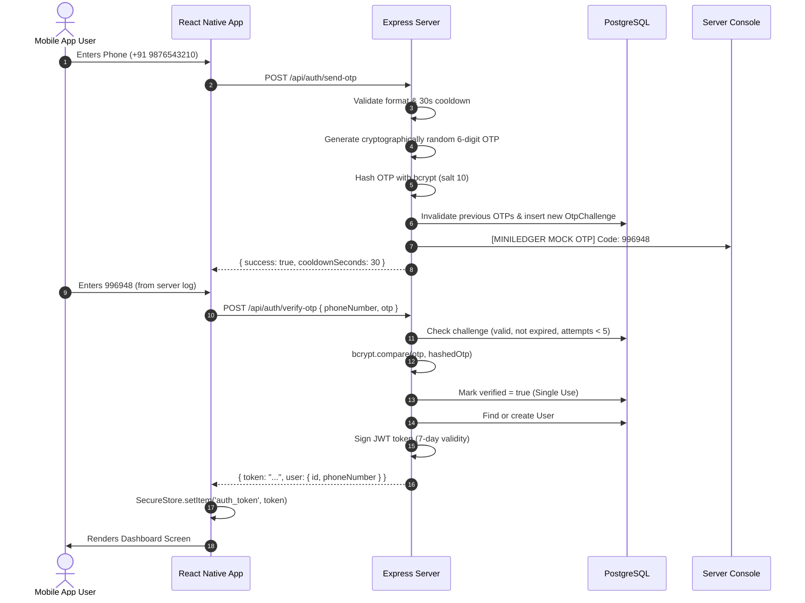

# MiniLedger Architecture & Technical Design

## 1. System Overview

MiniLedger is a full-stack, mobile-first peer-to-peer debt and credit ledger application engineered with:
- **Mobile Client**: React Native with Expo SDK 51, TypeScript, React Context, and a custom FinTech design system following anti-ai-slop principles.
- **Backend Server**: Node.js, Express, TypeScript, Zod validation, JWT authentication, and bcrypt.
- **Database & Persistence**: PostgreSQL with Prisma ORM, utilizing exact `Decimal(12, 2)` monetary representations and strict relational foreign-key ownership constraints.

---

## 2. Monorepo Structure

```text
miniledger/
├── apps/
│   └── mobile/              # React Native Expo Mobile App
│       ├── App.tsx          # Root container with AuthProvider & Navigation
│       ├── index.ts         # Native entry point
│       ├── app.json         # Expo project configuration
│       └── src/
│           ├── api/         # Typed API client with dynamic host resolution
│           ├── components/  # SummaryCard, LoanCard, StatusBadge, Modals, EmptyState
│           ├── context/     # AuthContext (state, tokens, session lifecycle)
│           ├── screens/     # LoginScreen, DashboardScreen, AddLoanScreen
│           ├── theme/       # Design tokens (colors, radii, shadows)
│           ├── types/       # TypeScript interfaces
│           └── utils/       # Storage (SecureStore fallback), currency formatting
├── server/                  # Express + TypeScript REST API
│   ├── prisma/
│   │   ├── schema.prisma    # PostgreSQL data model (Users, OtpChallenges, Loans)
│   │   └── seed.ts          # Reproducible test fixture seeder
│   └── src/
│       ├── config/          # Zod-validated environment config & multer
│       ├── controllers/     # AuthController, LoanController, SummaryController
│       ├── middleware/      # requireAuth, errorHandler, validateBody, validateParams
│       ├── routes/          # /api/auth, /api/loans, /api/summary, /api/health
│       ├── services/        # AuthService, LoanService, SummaryService
│       ├── utils/           # Logger (OTP console banner), crypto OTP, JWT
│       └── __tests__/       # Vitest integration test suite (19 test cases)
├── docs/                    # Architecture, API reference, demo walkthrough script
├── .gitignore
├── .env.example
├── package.json             # Root monorepo workspace scripts
└── README.md                # Submission guide & instructions
```

---

## 3. Database Schema & Data Integrity

### 3.1 PostgreSQL Schema Highlights

- **`users`**:
  - `id` (UUID, Primary Key)
  - `phone_number` (Unique, E.164 format index)
  - `created_at`, `updated_at` (Timestamps)
- **`otp_challenges`**:
  - `id` (UUID, Primary Key)
  - `phone_number`
  - `hashed_otp` (bcrypt hash with 10 salt rounds)
  - `attempts` (Integer, capped at 5)
  - `verified` (Boolean, single-use invalidation)
  - `expires_at` (10-minute expiry)
  - `created_at` (Used for 30s rate-limiting cooldown)
- **`loans`**:
  - `id` (UUID, Primary Key)
  - `user_id` (UUID, Foreign Key to `users.id` with `onDelete: Cascade`)
  - `friend_name` (String, indexed)
  - `amount` (`Decimal(12, 2)`: exact decimal arithmetic, prevents floating-point penny rounding bugs)
  - `due_date` (ISO Timestamp)
  - `status` (Enum: `PENDING` | `REPAID`)
  - `repaid_at` (Timestamp, set upon repayment)
  - `receipt_url` (String, optional uploaded receipt)
  - `notes` (String, optional memo)

### 3.2 Overdue Calculation Model

A loan is computed as **`OVERDUE`** when:
1. `status === 'PENDING'`, AND
2. `due_date < current_timestamp`.

The exact number of days overdue is calculated as:
$$\text{daysOverdue} = \left\lfloor \frac{\text{currentTime} - \text{dueDate}}{1000 \times 60 \times 60 \times 24} \right\rfloor$$

When marked as repaid:
- `status` is transitioned to `REPAID`.
- `repaid_at` is stamped.
- The loan is immediately excluded from `overdueAmount` in the summary calculations.

### 3.3 Strict Ownership Protection

All loan endpoints (`GET /api/loans`, `POST /api/loans`, `GET /api/loans/:id`, `PATCH /api/loans/:id/repay`, `GET /api/summary`) extract `user.id` strictly from the verified JWT payload. A user can never read, modify, or repay another user's loan. Any attempt results in a `404 Not Found / Access Denied` response, preventing enumeration attacks.

---

## 4. Mock OTP Authentication Flow



---

## 5. Mobile App Architecture & Design Decisions

### 5.1 Anti-AI-Slop Visual Direction: "FinTech Ledger"
- **Color Palette**: Dark slate theme (`#090D16`), deep cards (`#151D2E`), high-contrast emerald green for positive figures and repayments (`#10B981`), and vivid crimson for overdue warnings (`#F43F5E`).
- **Typography & Formatting**: Tabular currency figures using the Indian Rupee symbol (`₹`), readable thousands separators (`₹1,500.00`), uppercase micro-labels with tracking (`LENT AMOUNT`, `DUE DATE`).
- **User Feedback**:
  - Overdue warning banners on cards with overdue day counters.
  - Interactive status badges (`PENDING`, `OVERDUE`, `REPAID`).
  - Confirmation modal with amount review before marking as repaid.
  - Pull-to-refresh (`RefreshControl`) and immediate optimistic/reactive updates.
- **Dynamic Host Resolution**:
  - Android emulator automatically resolves `localhost` to `10.0.2.2`.
  - Physical devices connect to host local Wi-Fi IP (`192.168.1.103:4000`).
  - Web/local fallback to `localhost:4000`.
